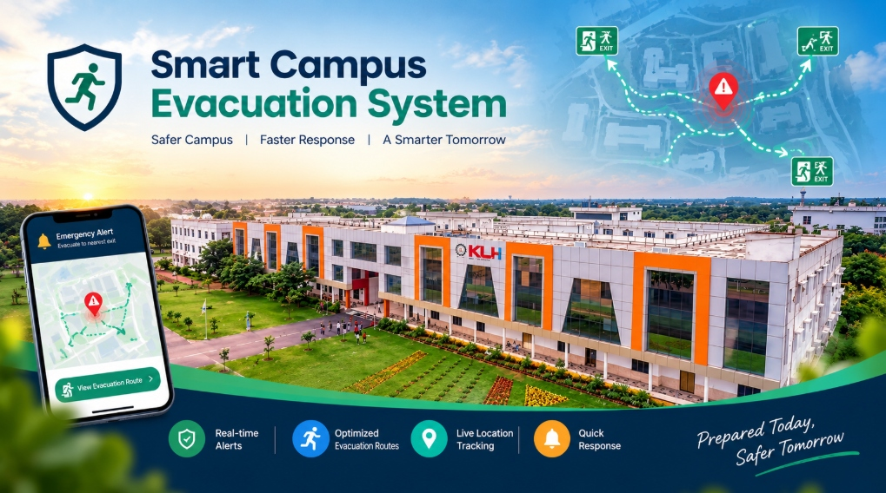
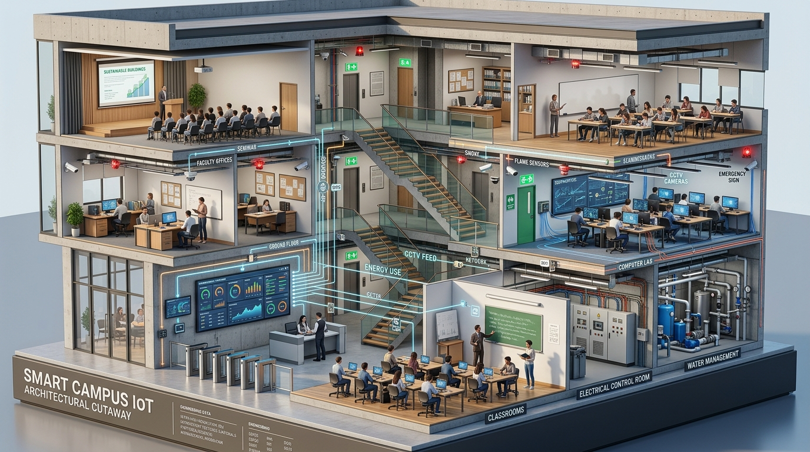

# 🏛️ Smart Campus Evacuation & Safety System — CampusGuard 360°
**KLH Smart Campus Digital Twin | SIH Winner Edition | Industry 4.0 Autonomous Safety**



### 3D Cutaway Architectural Model


CampusGuard 360° is an exhibition-grade, photorealistic 3D Digital Twin and Central Emergency Command Center engineered for university campuses. Designed with a **3D-first architecture**, all original monitoring, telemetry, and security surveillance capabilities are **100% preserved**, with new exhibition-ready presentation features added cleanly on top.

---

## 🌟 Preserved & Enhanced System Modules

### 1. 🎛️ Collapsible Side Panels
- **All Existing Monitoring Preserved**: The Left panel (Controls, Explode Slider, Incident Drills) and Right panel (Active Alerts, Room Status Matrix, Gauges, Event Log Stream) remain completely intact.
- **Collapsible with Smooth Transitions**: Use the `[-]` button on the panel header or the floating edge tabs (`Controls` / `Telemetry`) to collapse/expand panels smoothly.
- **Slightly Reduced Width**: Default panel width is optimized (`w-76` and `w-84`) to maximize 3D canvas visibility.

### 2. 🚀 Live Demo Mode
- **Fullscreen & Auto-Orbit**: One-click top button that enters fullscreen, temporarily hides side panels, and initiates slow orbital camera rotation.
- **Live Background Operations**: All telemetry, sensor animations, and backend alert monitoring continue running without interruption.
- **Floating Mini Alert Bar**: Displays live status notifications in real time at the top of the screen during demo mode.

### 3. 🏢 Floor View System
Select specific floor levels without removing any rooms:
- **`All Floors`**: Complete 3-floor building with roof and atrium.
- **`Ground Floor`**: Security Room, Classrooms G-01 to G-03, Reception turnstiles, Electrical Substation, Water Manifold.
- **`First Floor`**: Faculty Cabins, Computer & Robotics Lab, Classrooms 101–102, Corridors.
- **`Second Floor`**: Grand Seminar Hall, Administrative Offices, Classrooms 201–202.

### 4. 🎥 Camera Presets
Smooth TWEEN animations to predefined vantage points:
- **`🏫 Campus View`**: Isometric view of the building, roads, parking, and landscaping.
- **`🏢 Classroom View`**: Direct view into Classrooms G-01, G-02, and G-03.
- **`🛡 Security Room`**: Ground Floor central video wall and operator station.
- **`🔥 Fire Zone`**: 1F Robotics Lab fire and gas detection area.
- **`📡 Sensor View`**: Top-down view visualizing the encrypted 3D ESP-NOW data flow paths.

### 5. 🏷️ Sensor Visualization with Hover Tooltips
Interactive 3D markers with distinct iconography:
- 📹 **CCTV Cameras** (AI Edge face/violence/smoking detection)
- 🔥 **Flame Sensors** (IR photodiode array)
- ☁ **MQ2 Gas Sensors** (Smoke & toxic gas PPM)
- 💧 **Water Sensors** (Pipeline accumulation & solenoid shutoff)
- 🌡 **DHT22 Sensors** (Temperature & Humidity)
- 👤 **PIR Sensors** (Human motion detection & timetable verification)
- **Live Hover Tooltip**: Displays **Sensor Name**, **Status**, **Room**, **Live Reading**, and **Hardware Specs**.

### 6. 🚨 Emergency Command Mode
Activating **`🚨 EMERGENCY MODE`**:
- All existing monitoring and alerts remain active.
- Building lighting dims with a dramatic red emergency glow.
- Hazard zone flashes red.
- Dynamic emergency route arrows glow green.
- Audible alarm siren sounds (Web Audio synthesizer).
- Camera automatically focuses on the incident zone.

### 7. 🎨 Digital Twin Dynamic Heatmap
Rooms dynamically change color according to live sensor conditions:
- 🟢 **Green (Safe)**: All telemetry within normal baseline.
- 🟡 **Yellow (Warning)**: Environmental threshold deviations.
- 🟠 **Orange (Alert)**: Room G-03 Faculty Absent Anomaly (students present, lecturer absent >15m).
- 🔴 **Red (Critical)**: Active fire flame / toxic gas leak >400 PPM.
- 🔵 **Blue (Water Leak)**: Pipe rupture & solenoid valve auto-isolated.

### 8. 🌳 Realistic Campus Environment
- Paved perimeter roads with dashed white lane stripes.
- Parking area with stylized parked 3D cars.
- Campus entrance gate with security cabin and boom barrier.
- Street lamps with glowing lamp fixtures.
- Landscaped greenery (trees, shrubs) and student pedestrians.

### 9. 🎤 SIH Presentation Mode (9-Step Autonomous Tour)
Clicking **`PRESENTATION MODE`** automatically cycles through all 9 key modules:
1. **Classroom Occupancy & Climate Monitoring** (Room G-01)
2. **Faculty Absent Alert** (Room G-03 alert badge & security flag)
3. **Student Fight Detection** (CAM-101 YOLOv8 94.2% violence bounding box)
4. **Smoking Detection** (CAM-204 stairwell cigarette plume 91.8%)
5. **Fire Detection System** (1F Lab flame sensor, smoke particles, strobe sirens)
6. **Gas Leakage Detection** (MQ-2 gas spike to 680 PPM, exhaust dampers)
7. **Water Leakage Management** (Solenoid valve auto-shutoff to 0 BAR)
8. **Security Office Alert Handling** (Ground Floor monitoring center)
9. **Real-Time Dashboard Analytics** (Occupancy trends, risk radar, Safety Score)

### 10. 📊 Preserved Multi-View Modes
- **3D Model**: Interactive WebGL cutaway digital twin.
- **AI CCTV Wall**: 6-channel live simulated surveillance feeds with YOLO bounding boxes.
- **IoT Grid**: Health status cards for all 8 ESP32 mesh nodes.
- **AI Analytics**: Modern Chart.js telemetry charts and campus safety scorecard (98.4/100).

### 11. 🎙️ Acoustic Surveillance & Audio Intelligence
- **Faculty Presence Detection**: Monitors vocal lecture spectrum (48–74 dB). Vocal silence (< 45 dB) with students present triggers a faculty absence alert.
- **Student Fight Detection**: Real-time acoustic shock monitoring (> 85 dB screams and disturbance) correlated with corridor CCTV.
- **Stairwell Smoking Detection**: Secluded acoustic profiling (< 35 dB) correlated with MQ-2 aerosol spikes in non-smoking zones.

---

## ⚡ Wokwi ESP32 IoT Simulation (`wokwi/`)

The repository includes a complete, production-grade **Wokwi simulation** driven by an **ESP32 DevKit V1**:

- **`wokwi/diagram.json`**: Complete breadboard schematic with all sensors, actuators, and wiring.
- **`wokwi/sketch.ino`**: Optimized C++ firmware with edge detection, debouncing, zero startup false alarms, and rotating LCD 20x4 display.
- **`wokwi/libraries.txt`**: Required dependencies (`LiquidCrystal_I2C`, `DHT sensor library`).
- **`wokwi/README_WOKWI.md`**: Detailed hardware guide, pinouts, and testing scenarios.

### Hardware Mapping Summary:
| ESP32 Pin | Component | Function |
| :--- | :--- | :--- |
| **GPIO 21 & 22** | LCD 20x4 I2C | Security Office live status display (`0x27`) |
| **GPIO 4** | Buzzer | Emergency evacuation alarm siren |
| **GPIO 2** | Green LED | Safe / Normal campus status |
| **GPIO 12** | Yellow LED | Warning / Faculty Absent alert |
| **GPIO 16** | Red LED | Critical fire / fight alert strobe |
| **GPIO 17** | Blue LED | Water pipe leak indicator |
| **GPIO 32, 33, 25, 26**| PIR Sensors | Classroom & seminar hall occupancy |
| **GPIO 27, 14, 13, 15**| DHT22 Sensors | Room climate & temperature/humidity |
| **GPIO 34 & 35** | MQ-2 Gas Sensors | Combustible gas & stairwell smoking detection |
| **GPIO 36 (VP)** | Flame Sensor | 1F Computer lab optical fire detector |
| **GPIO 39 (VN)** | Sound / Mic Sensor | Decibel level audio monitoring (30–110 dB) |
| **GPIO 19, 18, 5, 23** | Pushbuttons | Simulation triggers: Faculty Absent, Fight, Emergency, Water Leak |

---

## 🚀 How to Run

### 1. 3D Digital Twin Command Center
Simply open `index.html` in any modern web browser (Chrome, Edge, Firefox, Safari):
```powershell
Start-Process "index.html"
```

### 2. Wokwi ESP32 Simulation
- Open [Wokwi](https://wokwi.com/), create an ESP32 project, and copy `wokwi/diagram.json` and `wokwi/sketch.ino`.
- Or use the Wokwi VS Code extension with `wokwi.toml`.
- Observe real-time Serial output at 115200 baud and rotating 20x4 LCD screens.

---

## 🚀 Running the Command Center

```powershell
# Open in your default browser:
Start-Process "C:\Users\Admin\.gemini\antigravity\scratch\smart-campus-monitoring\index.html"
```
